# Solving the Steady-State Heat Equation. Part 1. The One-Dimensional Case

If the ends of a rod are held at constant temperatures, the temperature distribution along it can be found without a computer: it is linear. So why solve this problem numerically? Make it just a little more complicated — let heat be generated only in part of the rod, or move from a rod to a plate — and there is no longer a simple analytical solution, so numerical methods become necessary. The one-dimensional problem is a convenient testing ground: the methods are easy to understand on it, and the answer is known in advance, so each method can be checked.

In this article we will go all the way from the heat equation and boundary conditions, through the finite difference method, to a system of linear algebraic equations (SLAE). Then we will look at how to solve it: with direct methods (Gaussian elimination and the tridiagonal matrix algorithm) and iterative methods (Jacobi, Gauss–Seidel, successive over-relaxation). The main methods are worked through on examples that can be computed by hand, with cost estimates and pitfalls.

## 1. Description

Heat conduction is the molecular transfer of heat in a continuous medium. This process arises when the temperature distribution is non-uniform.

Unsteady heat transfer by conduction is described by the following equation:

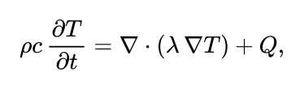

where ρ is the density, c is the specific heat capacity, λ is the thermal conductivity, and Q is the power of internal heat sources.

If the boundary conditions and sources do not change in time, then after a sufficiently long time the temperature stops changing: ∂T/∂t = 0. What remains is the **steady-state heat equation**:

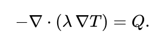

For constant λ this is the **Poisson equation**:

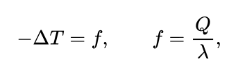

and in the absence of sources (Q = 0) it is the **Laplace equation** (this is the case we will consider from here on)

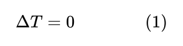

Equation (1) describes a multitude of possible heat conduction processes. To select one of these countless variants and give it a complete mathematical description, relation (1) must be supplemented with uniqueness conditions, which include geometric, physical, initial and boundary conditions.

- **Geometric conditions** define the shape and size of the body in which the process takes place.
- **Physical conditions** define the thermophysical properties of the body λ, ρ, c (not needed in our case).
- **Time (initial) conditions** contain the temperature distribution in the body at the initial moment (not needed in our case).
- **Boundary conditions** define how the process behaves on the surface of the body and can be specified in several ways.

## 1.1 Boundary conditions

**Boundary conditions of the first kind (Dirichlet)** — the temperature distribution on the surface (or boundary) of the body is specified:

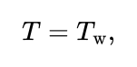

where T_w is the temperature on the surface of the body.

**Boundary conditions of the second kind (Neumann)** — the heat flux is specified at every point of the surface (or boundary) of the body:

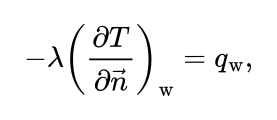

where n is the normal to the surface of the body.

**Boundary conditions of the third kind** — a relationship is specified between the conductive heat flux from the solid wall and the heat flux to the surrounding medium driven by the temperature difference (Newton's law of cooling)

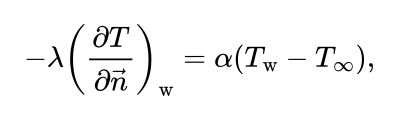

where α is the heat transfer coefficient and T_∞ is the ambient temperature.

**Boundary conditions of the fourth kind** — to describe the thermal interaction between elements with different thermophysical properties, equality of temperatures and heat fluxes on both sides of the interface is required:

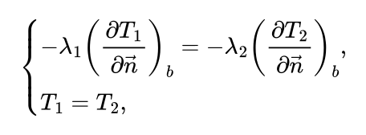

where b is the interface between the media; T₁, T₂ are the temperatures of the media in contact. This condition is used, for example, when solving heat conduction problems for multilayer plates.

The differential equation (1) together with the uniqueness conditions gives a complete mathematical formulation of the heat conduction boundary value problem.

## 2. Finite difference method

We will solve equation (1) with the corresponding boundary conditions numerically. The method most often used for solving partial differential equations is the **finite difference method**. The solid body is represented as a set of nodes. By approximating the partial derivatives of the differential equation (1) with finite differences, one obtains a system of linear algebraic equations for the temperature as a local quantity at each grid node. The resulting system is not closed; to close it, a difference representation of the boundary conditions is used. The result is a closed system of linear algebraic equations, which is solved numerically.

## 2.1 The one-dimensional case

Consider a rod of length L. Divide it along its length into Nₓ − 1 equal intervals

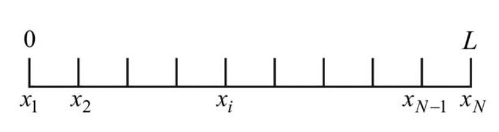

In the one-dimensional case, the heat equation (1) takes the form:

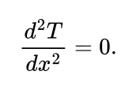

Replacing the differential operator with its finite difference analogue, we get:

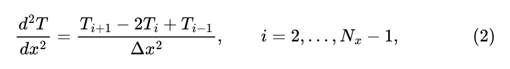

where i is the node index, Nₓ is the number of grid nodes, and Δx is the grid spacing in x. T₁ and T_Nₓ are determined from the boundary conditions:

- Boundary conditions of the first kind

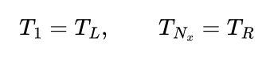

- Boundary conditions of the second kind

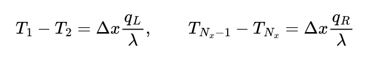

- Boundary conditions of the third kind

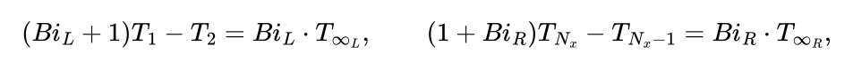

where Bi = α·Δx/λ.

As a result, we obtain a **system of linear algebraic equations (SLAE)**:

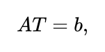

where A is the coefficient matrix, T is the vector of unknowns, and b is the right-hand side vector. **For boundary conditions of the first kind**

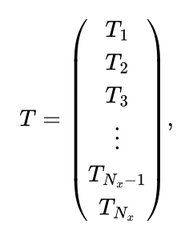

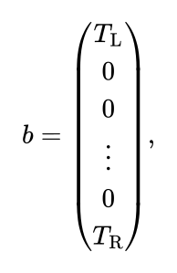

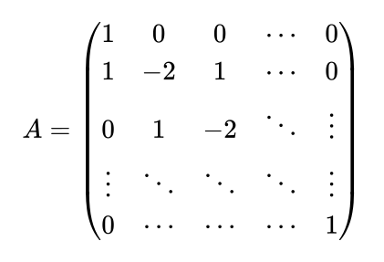

## 2.2 Analytical solution

Before solving the system, note that our problem has an exact solution. Integrating the equation ∂²T/∂x² = 0 twice, we get a linear function

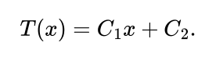

We find C₁ and C₂ from the boundary conditions of the first kind: T(0) = T_L gives C₂ = T_L, and T(L) = T_R gives C₁ = (T_R − T_L)/L. So the temperature varies linearly along the rod:

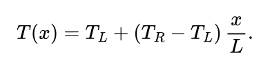

This solution can be used as a **reference** for comparison with the numerical results.

With boundary conditions of the second kind at both ends, the constants cannot be found this way. The flux determines only the slope dT/dx = C₁, while the temperature level C₂ remains free: the solution is determined only up to a constant (physically, only the flux is specified, not the temperature level). Moreover, both conditions specify the same slope, so the fluxes at the ends must be consistent: as much heat as enters the rod must leave it, otherwise there is no steady-state solution at all. Therefore, a condition of the first or third kind must be specified on at least one boundary.

One question remains: how do we solve the resulting system of equations? We will look at this in the next section.

## 3. Solving the SLAE

Methods for solving SLAEs fall into two large groups:

- **direct (exact)** — give the solution in a finite number of arithmetic operations known in advance (Gaussian elimination, the tridiagonal matrix algorithm);
- **iterative** — build a sequence of approximations T⁽⁰⁾, T⁽¹⁾, … that converges to the exact solution (Jacobi, Gauss–Seidel, successive over-relaxation).

The choice of method is determined by the structure of the matrix A, so let us first look at its properties.

## 3.1 Matrix properties

Let us write each equation of the system in general form:

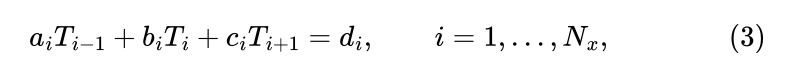

where a₁ = 0 and c_Nₓ = 0 (the first node has no left neighbour, the last has no right one), and dᵢ are the components of the right-hand side vector. For interior nodes, from (2): aᵢ = 1, bᵢ = −2, cᵢ = 1, dᵢ = 0. For boundary conditions of the first kind: b₁ = 1, c₁ = 0, d₁ = T_L and a_Nₓ = 0, b_Nₓ = 1, d_Nₓ = T_R.

This reveals three important properties of the matrix A:

1. **Tridiagonality** — non-zero elements appear only on the main diagonal and the two diagonals adjacent to it.
2. **Sparsity** — out of Nₓ² elements, at most 3Nₓ are non-zero. For example, with Nₓ = 1000 this is ≈ 3000 non-zero elements out of 10⁶. Storing such a matrix in full and solving the system "head-on" is wasteful.
3. **Diagonal dominance** — the absolute value of the diagonal element is not less than the sum of the absolute values of the other elements in the row:

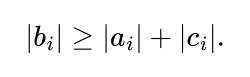

In interior rows equality holds (|−2| = |1| + |1|), while in rows with boundary conditions of the first and third kind the inequality is strict. This property guarantees the stability of the tridiagonal matrix algorithm and the convergence of the Jacobi and Gauss–Seidel iterative methods.

## 3.2 Direct methods

## 3.2.1 Gaussian elimination

The idea of the method is the same as in school: eliminate the unknowns one by one until a single equation with a single unknown remains. Solve it, and then find the rest in turn.

**A simple example**

Let us solve a system of three equations:

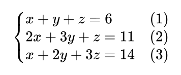

**Step 1 — eliminate x from equations (2) and (3).** Subtract twice (1) from (2), and subtract (1) from (3):

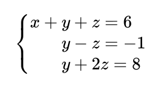

**Step 2 — eliminate y from the last equation.** Subtract the second equation from it:

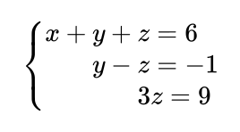

The system has taken a "staircase" form (**triangular form**): the last equation has one unknown, the one before it has two, and so on.

**Step 3 — find the unknowns from the bottom up:**

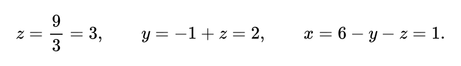

Steps 1–2 are called **forward elimination** (reducing the system to the staircase), and step 3 is **back substitution** (finding the unknowns from the bottom up). This is Gaussian elimination.

**The same in matrix notation**

There is no need to write the letters x, y, z — a table of coefficients with the right-hand side appended on the right (the **augmented matrix**) is enough. All operations are performed on the rows of this table.

There is a single rule: to get a zero below the diagonal, subtract from the row the row containing the diagonal element (called the **pivot**), multiplied by

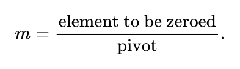

Proceed column by column from left to right until only zeros remain below the diagonal.

**Example for our problem**

Take a rod with Nₓ = 4 nodes, T_L = 100, T_R = 40:

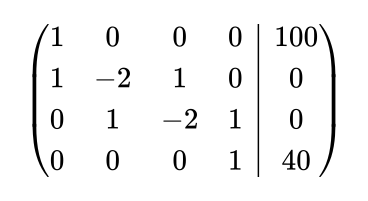

**Column 1.** The pivot is 1. A zero is needed only in the second row: subtract the first row from it (m = 1/1 = 1). The third and fourth rows already have zeros there.

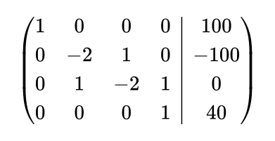

**Column 2.** The pivot is −2. A zero is needed in the third row: m = 1/(−2) = −½, i.e. add half of the second row to the third (subtract from the third row the second row multiplied by −½).

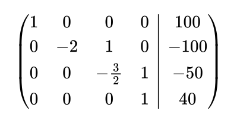

**Column 3.** There is already a zero below the diagonal — nothing to do. The staircase is ready.

**Back substitution** — read the rows from the bottom up:

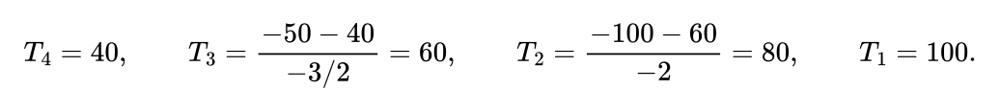

We obtained the linear profile 100, 80, 60, 40 — as expected (section 2.2).

Note: almost all of the operations came down to "subtract a row multiplied by zero", i.e. doing nothing. Gaussian elimination does not know this and dutifully goes through every element. The tridiagonal matrix algorithm (section 3.2.2) is the same Gaussian elimination that knows in advance where the zeros are and skips them.

**How much it costs**

To zero out one column, almost all rows have to be processed, and in each row almost all elements. There are N columns, N rows and N elements per row — on the order of N³ operations in total (more precisely, ⅔N³). Back substitution is much cheaper — on the order of N².

For N = 1000 nodes this is about 7·10⁸ operations.

**Pitfall: the pivot**

We have to divide by the pivot. If it is zero, the method breaks down even though a solution exists. For example:

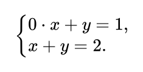

The first row cannot be used to eliminate x — its coefficient of x is zero. The fix is simple: **swap the rows**, and everything works.

A similar problem occurs if the pivot is not zero but very small: then m becomes huge and rounding errors spoil the answer. Therefore, programs usually choose, at every step, the row with the **largest absolute value** element in the current column and put it in the pivot position (**partial pivoting**).

For our matrix this is unnecessary: it is diagonally dominant (section 3.1), and the pivots never become small.

**Algorithm**

Given: an N × N matrix A and a right-hand side column b.

**Forward elimination** — repeat for each column k = 1, 2, …, N−1:

1. Take the pivot a_kk (on the diagonal in the k-th column).
2. *(If pivoting is needed.)* In the k-th column, starting from row k and below, find the row p with the largest absolute value element:

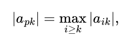

and swap rows p and k — together with the right-hand side elements b_p and b_k.

3. For each row i below the pivot row (i = k+1, …, N):

3.1. compute the multiplier

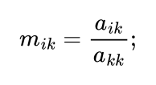

3.2. subtract from the i-th row of the matrix the k-th row multiplied by m_ik:

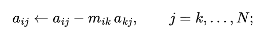

3.3. do the same with the right-hand side:

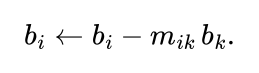

After this, there are zeros below the diagonal — the system has a staircase form:

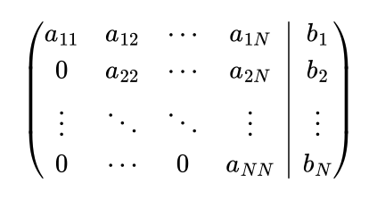

(here a_ij and b_i are the values already modified by forward elimination).

**Back substitution** — repeat for rows i = N, N−1, …, 1 (from the bottom up):

1. Take the right-hand side b_i.
2. Subtract from it the contribution of the already found unknowns T_{i+1}, …, T_N:

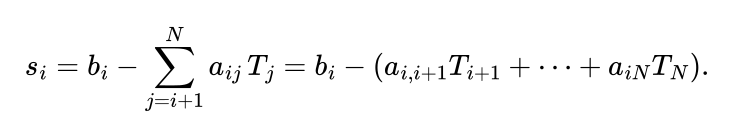

The unknowns T₁, …, T_{i−1} do not appear in the i-th equation: after forward elimination there are zeros to the left of the diagonal. For the last row (i = N) there is nothing to subtract: s_N = b_N.

3. Divide the result by the diagonal element:

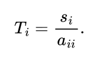

Combining the steps, we get:

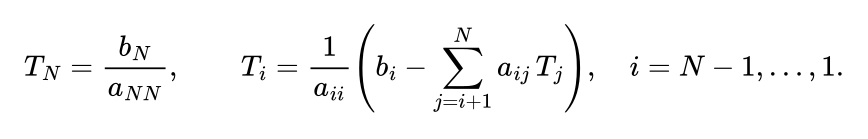

Result: the vector T = (T₁, …, T_N)ᵀ.

## 3.2.2 Tridiagonal matrix algorithm (Thomas algorithm)

In our system, each equation links only three neighbouring unknowns: T_{i−1}, T_i and T_{i+1}. Therefore, from the first equation we can express T₁ in terms of T₂, substitute it into the second and express T₂ in terms of T₃, and so on to the end. The last equation will contain a single unknown, and then we can go back and find all the others in turn. The unknown is, as it were, "swept" along the chain and back, which is why the method is also called the **sweep method**.

**A simple example**

Let us solve a system in which each equation contains at most three neighbouring unknowns:

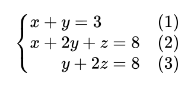

**Step 1 — express x in terms of y** from equation (1):

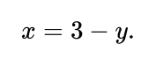

**Step 2 — substitute into (2) and express y in terms of z:**

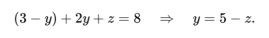

**Step 3 — substitute into (3).** Only one unknown remains:

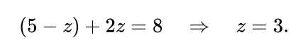

**Step 4 — go back**, substituting what we found into the expressions already obtained:

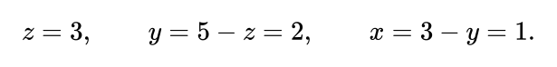

Steps 1–3 are called the **forward sweep**: we go from left to right and obtain expressions of the form "x in terms of y", "y in terms of z". Step 4 is the **backward sweep**: we go from right to left and find the unknowns.

This is the same Gaussian elimination (section 3.2.1): substituting x into (2) is the same as eliminating x from (2). The difference is that the sweep does not waste time on zeros: in each equation it works with only three coefficients.

**The same in general form**

Write the system in the form (3):

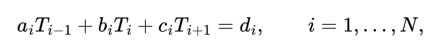

where a₁ = 0 (there is nothing to the left of the first node) and c_N = 0 (nor to the right of the last). In the example a = (0, 1, 1), b = (1, 2, 2), c = (1, 1, 0), d = (3, 8, 8).

In the forward sweep, every expression has the same form: "the previous unknown in terms of the next one":

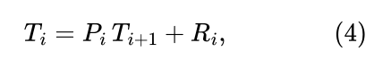

where P_i and R_i are numbers called the **sweep coefficients**. In the example x = −1·y + 3, i.e. P₁ = −1, R₁ = 3; y = −1·z + 5, i.e. P₂ = −1, R₂ = 5.

**Where the formulas come from.** Suppose the expression for T_{i−1} is already known: T_{i−1} = P_{i−1}·T_i + R_{i−1}. Substitute it into the i-th equation:

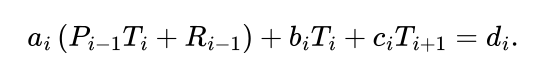

Collect the terms with T_i on the left:

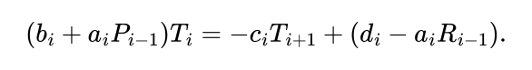

Denote the denominator β_i = b_i + a_i·P_{i−1} and divide by it. We get an expression of the form (4) with coefficients

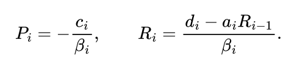

For the first equation there is no previous unknown (a₁ = 0), so β₁ = b₁:

In the last equation there is no next unknown (c_N = 0), so P_N = 0 and immediately T_N = R_N. This is where the backward sweep starts.

Let us check on the example:

Backward sweep: T₃ = R₃ = 3, T₂ = −1·3 + 5 = 2, T₁ = −1·2 + 3 = 1. We obtained the same answer.

**Example for our problem**

Take a rod with Nₓ = 4 nodes, T_L = 100, T_R = 40 (as in section 3.2.1). Row coefficients:

**Forward sweep:**

**Backward sweep:**

We obtained the same linear profile 100, 80, 60, 40.

Compare the denominators β_i with the pivots in the example from section 3.2.1: they were also 1, −2, −3/2, 1. The sweep performs the same operations as Gaussian elimination, only it skips the zeros.

**How much it costs**

The forward sweep spends about six operations per node (one addition and one multiplication for β_i, a division for P_i, a multiplication, a subtraction and a division for R_i), and the backward sweep two. That is about 8N operations in total, i.e. O(N).

For N = 1000 nodes this is about 8·10³ operations versus 7·10⁸ for Gaussian elimination.

Memory is also O(N): only the three diagonals a, b, c, the right-hand side d and the coefficients P, R are stored. The N × N matrix itself does not need to be stored.

For the one-dimensional problem this is the optimal method: it is impossible to do better than O(N), because each of the N unknowns has to be computed at least once.

**Pitfall: division by β_i**

As in Gaussian elimination, each step involves a division, here by β_i. If β_i = 0, the method breaks down, and if β_i is very small, rounding errors grow. Swapping rows as in Gaussian elimination is not allowed here: it would destroy the tridiagonal structure.

Fortunately, with **diagonal dominance**

(strict in at least one row) this does not happen. Let us show that then |P_i| ≤ 1. Suppose |P_{i−1}| ≤ 1. Then

The denominator is not less than |c_i|, the coefficients P_i do not grow, and rounding errors do not accumulate.

Our matrix satisfies this condition (section 3.1): in interior rows |−2| = 1 + 1, and in rows with boundary conditions of the first kind |1| > 0.

> With conditions of the second kind at both ends, the last denominator turns out to be β_N = 0. The product of all β_i equals the determinant of the matrix, so the matrix is singular — this is the same non-uniqueness of the solution discussed in section 2.2.

**Algorithm**

Given: coefficients a_i, b_i, c_i and right-hand sides d_i, i = 1, …, N, with a₁ = 0, c_N = 0.

**Forward sweep** — compute the sweep coefficients from left to right:

1. For the first row:

2. For each row i = 2, …, N:

2.1. compute the denominator

2.2. compute

2.3. compute

**Backward sweep** — compute the temperatures from right to left:

1. For the last row P_N = 0, so

2. For each row i = N−1, …, 1:

Result: the vector T = (T₁, …, T_N)ᵀ.

## 3.2.3 Other direct methods

For the one-dimensional problem the sweep is optimal. There are other direct methods worth knowing, since they come up in the literature.

- **LU decomposition** (PA = LU, L is lower triangular, U is upper triangular, P is a row permutation) — Gaussian elimination with the multipliers stored. It costs the same (~⅔N³), but then each new right-hand side is solved in O(N²). Beneficial when there is one matrix and many right-hand sides (an implicit scheme in an unsteady problem). The sweep is its special case for a tridiagonal matrix.
- **Cholesky decomposition** (A = LLᵀ) — a variant of LU for symmetric positive definite matrices, twice as cheap (~⅓N³) and requiring no pivoting. Our matrix becomes such a matrix if the boundary nodes with first-kind conditions are eliminated and the equations are multiplied by −1: the result is tridiag(−1, 2, −1).
- **LDLᵀ decomposition** — a variant of Cholesky for symmetric but not necessarily positive definite matrices (D is diagonal). It requires no square roots.
- **QR decomposition** (A = QR, Q is orthogonal) — the most stable, but roughly twice as expensive as LU. Used mainly in least-squares problems. Overkill for our well-conditioned matrices.
- **Sparse LU and Cholesky.** In 2D/3D the main problem is not the number of operations but **fill-in**: L and U contain many more non-zero elements than A. Therefore, before factorization the unknowns are reordered (AMD, nested dissection algorithms) to reduce fill-in.

## 3.3 Iterative methods

In the one-dimensional case, the sweep solves the problem exactly and quickly. In two and three dimensions each node already has four and six neighbours, the sweep is not directly applicable, and Gaussian elimination and LU decomposition require a lot of memory and time. That is when iterative methods are used. Let us look at them on the one-dimensional problem, where they are easy to understand.

All iterative methods share one idea: take some approximation to the solution T⁽⁰⁾ (for example, zero or linear between the boundary values) and improve it step by step using the same rule. This gives a sequence T⁽⁰⁾, T⁽¹⁾, T⁽²⁾, … that approaches the exact solution. k is the **iteration** number.

For iterative methods, it is convenient to write each equation from section 2.1 in the form "temperature at a node in terms of its neighbours". At interior nodes, from (2) we get

i.e. the temperature at a node equals the **arithmetic mean** of its neighbours' temperatures. At boundary nodes, for example at the left end:

- first kind: T₁ = T_L;
- second kind: T₁ = T₂ + Δx·q_L/λ;
- third kind: T₁ = (T₂ + Bi_L·T_∞) / (1 + Bi_L).

At the right end the neighbour is T_{Nₓ−1}, and the formulas are obtained from section 2.1 in exactly the same way.

## 3.3.1 Jacobi method

Recompute the temperatures at all nodes using the formulas above, substituting the **old** values of the neighbours into the right-hand sides. We get a new approximation and repeat.

**A simple example**

Let us solve the system

Its exact solution is x = 1, y = 2.

Express x from (1) and y from (2):

Start with x = 0, y = 0 and substitute the values from the previous row of the table into the right-hand sides:

The approximations oscillate around the answer (1, 2) and get closer to it with each iteration. We will not get the exact answer in a finite number of steps, but we can get arbitrarily close to it. This is the main difference from direct methods.

**Formulas for our problem**

At interior nodes, the new temperature is the mean of the **old** temperatures of the neighbours:

At boundary nodes — the formulas from the beginning of the section, also with the old value of the neighbour:

- first kind: T₁⁽ᵏ⁺¹⁾ = T_L (the boundary value does not change);
- second kind: T₁⁽ᵏ⁺¹⁾ = T₂⁽ᵏ⁾ + Δx·q_L/λ;
- third kind: T₁⁽ᵏ⁺¹⁾ = (T₂⁽ᵏ⁾ + Bi_L·T_∞) / (1 + Bi_L).

It is important that all new values are computed **from the old ones only**. Therefore two arrays are needed: the old T⁽ᵏ⁾ and the new T⁽ᵏ⁺¹⁾. If the new values are written directly into the old array, the result is a different method — the Gauss–Seidel method (below).

**Example for our problem**

Take a rod with Nₓ = 4 nodes, T_L = 100, T_R = 40 (as in section 3.2.1). The exact solution is 100, 80, 60, 40. Set the boundary values correctly right away and take the interior ones as zero: T⁽⁰⁾ = (100, 0, 0, 40). At the interior nodes

The error is **exactly halved** with each iteration. To get, for example, an error below 10⁻⁶, about 27 iterations are needed. Physically this resembles heat gradually "seeping" from the hot and cold ends into the rod.

**How much it costs**

**One iteration** is cheap: one addition and one division by 2 per node, about 2Nₓ operations in total, i.e. O(Nₓ).

**The number of iterations** depends on how much the error is reduced per iteration. At Nₓ = 1000 the Jacobi method turns out to be slower than even Gaussian elimination (7·10⁸). For the one-dimensional problem it is impractical. But it is very simple, and in 2D/3D it takes little memory and parallelizes easily: all nodes are computed independently of one another.

**Why it is so slow.** In one iteration a node learns only about its immediate neighbours. Information about a boundary value advances by one node per iteration, and just to reach the middle of the rod at least Nₓ/2 iterations are needed. Moreover, smooth (long-wavelength) errors are barely affected by averaging: for a smooth function the mean of the neighbours almost coincides with the value at the node. Only "jagged" errors that change sign from node to node are damped quickly.

**Algorithm**

Given: the number of nodes Nₓ, boundary conditions, the initial guess T⁽⁰⁾, the tolerance ε and the maximum allowed number of iterations K.

Repeat for k = 0, 1, 2, …, K−1:

1. For each interior node i = 2, …, Nₓ − 1, compute the new value from the **old** values of the neighbours:

2. Compute the new values at the boundary nodes T₁⁽ᵏ⁺¹⁾ and T_Nₓ⁽ᵏ⁺¹⁾ using the formulas for the corresponding kind of boundary condition (also from the old values of the neighbours).
3. Compute the change:

4. If Δ⁽ᵏ⁺¹⁾ < ε, stop: the answer is T⁽ᵏ⁺¹⁾. Otherwise move on to the next iteration, and the new approximation becomes the old one.

If the tolerance has not been reached within K iterations, stop and report it: the method converges too slowly or does not converge at all.

## 3.3.2 Gauss–Seidel method

The nodes are traversed from left to right, and the value of the left neighbour T_{i−1}⁽ᵏ⁺¹⁾, already computed in the current iteration, is used immediately:

Memory is saved as well: a single array is enough, with values overwritten "in place".

## 3.3.3 Successive over-relaxation (SOR)

The new Gauss–Seidel value T̃_i is "amplified" with the relaxation parameter ω:

With ω = 1 we get the Gauss–Seidel method, and with ω > 1 over-relaxation: the correction is made larger than Gauss–Seidel suggests, "with a margin". For a rod with conditions of the first kind the optimal value is

## 3.3.4 Stopping criterion

Iterations are stopped when the change in the solution becomes small, or when the residual r_i⁽ᵏ⁾ = T_{i−1}⁽ᵏ⁾ − 2T_i⁽ᵏ⁾ + T_{i+1}⁽ᵏ⁾ (how far the equations are from being satisfied) becomes small:

With slow convergence, both criteria show a value noticeably smaller than the true error. Therefore the threshold is chosen with a margin.

## 3.3.5 Rate of convergence

The Jacobi and Gauss–Seidel methods converge much more slowly than SOR, so in practice SOR or more advanced methods (conjugate gradients, multigrid) are used.

## 3.3.6 Other iterative methods

They are not needed for the one-dimensional problem: the sweep already solves it in O(Nₓ). The choice of iterative method becomes important in 2D/3D. Below, Nₓ is the number of nodes along one side.

- **Conjugate gradient method (CG)** — at each iteration it chooses the correction direction and step length by itself, taking all previous steps into account, so there is no parameter like ω to tune. The number of iterations is O(Nₓ), as with SOR, but without tuning. It requires a symmetric form of the equations (see the Cholesky decomposition in section 3.2.3).
- **Preconditioned CG (PCG)** — the problem is first solved approximately by a cheap method, and CG only refines the result. Usually an incomplete Cholesky factorization, which creates no new non-zero elements, is used for this. With the modified variant (MIC), O(√Nₓ) iterations are needed. This is the workhorse for medium-sized problems.
- **Multigrid method** — a few Jacobi or Gauss–Seidel iterations quickly damp the "jagged" error, and the remaining smooth error is transferred to a grid twice as coarse. There it becomes "jagged" and is also damped quickly. The number of iterations does not depend on the grid size, and the total work is O(N), where N is the total number of nodes. This is asymptotically optimal. It is often used as a preconditioner for CG.
- **Alternating direction implicit method (ADI)** — for rectangular grids in 2D/3D: the equations are solved alternately along all rows and then along all columns, and each line is solved with the sweep (section 3.2.2). With a suitably chosen sequence of parameters, O(log Nₓ) iterations are needed.
- **GMRES, BiCGStab** — analogues of CG for non-symmetric problems (for example, with convection), usually with an ILU preconditioner.

## 4. Conclusion

Let us gather the methods considered into one table:

In the one-dimensional problem, iterative methods lose to the sweep. In the second part we will move on to the two-dimensional problem: each node will have four neighbours, the matrix will no longer be tridiagonal, the sweep will not be directly applicable, and the other direct methods will require too much memory. That is when iterative methods can become the main tool.

MATLAB code for all the methods in this article: [link to repository](https://github.com/Semen1996/steady-state-heat-1d).
